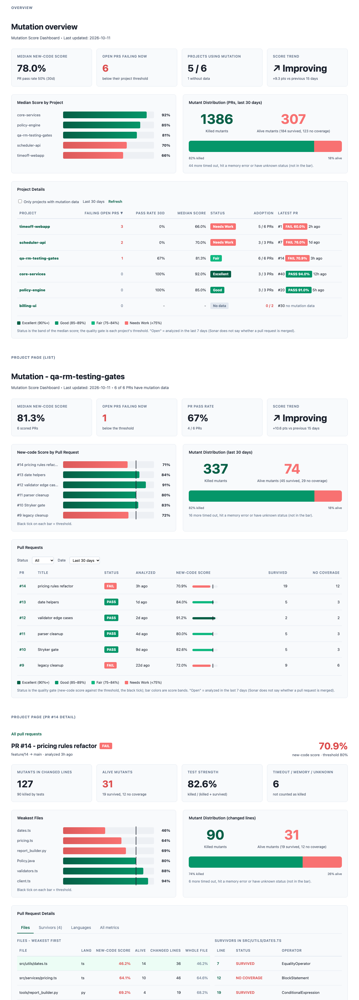

# sonar-mutation-report-plugin

A language-agnostic SonarQube plugin that publishes **mutation testing results** as Sonar measures, so a
quality gate can block a pull request when the mutation score is below a threshold.

The plugin **runs no mutation testing** and knows nothing about languages. An external agent runs the
mutation tools (Stryker, PIT, mutmut, ...), improves the tests, and writes one JSON report. During the
normal Sonar scan the plugin reads that file and publishes its numbers.

> **Status: v1.0.0 (dashboard: before and after the agent).** v0.2.0's full metric set (per-file measures with
> folder/project aggregation, new-code variants, per-language measures, survivor issues) plus two read-only
> dashboard pages for pull requests (see "Dashboard"). v0.4.0 shows what the agent changed: the score before and
> after, the time it took, the scan date and an optional portfolio. Verified on a local SonarQube 26.1 and, with
> mock pull request analyses, on sonartest (see "Verification"). Tested over time across multiple repositories.

## Why a plugin

SARIF import can only create issues, so it cannot populate Overall Code or New Code with a score. The
Sonar web API cannot create custom metrics on 2026.1, and the existing DevCon5 mutation plugin only
works for Java and Kotlin. A small plugin that registers its own metrics is the supported way to get a
real, gateable measure for any language.

## What it publishes

All keys use the domain **Mutation Analysis**. Every metric below also exists as `new_mutation_<name>`
(New Code), except where noted. File-level values are saved per file and aggregated to folders and the
project, so the Measures page has a file tree, drill-down and treemap.

| Metric key (`mutation_<name>`) | Meaning | Aggregation |
|---|---|---|
| `total` | mutants generated | sum |
| `killed` | killed by tests (**the score numerator**) | sum |
| `timed_out`, `memory_error` | detected by timeout / memory error | sum |
| `killed_total` | killed + timed out + memory error (DevCon5's "Killed: Total") | sum |
| `survived`, `no_coverage` | alive: tests run the line but miss / no test reaches it | sum |
| `alive` | survived + no coverage | sum |
| `unknown`, `suppressed` | unknown status / excluded as equivalent | sum |
| `tests_executed`, `test_kills` | per-test data, only when the engine supplies it (absent otherwise) | sum |
| `score` | killed / total (**the gate metric**) | recomputed from counts |
| `test_strength` | killed / (killed + survived) | recomputed |
| `density` | mutants per analyzable line, in percent | recomputed |
| `alive_percent`, `total_percent` | component's share of project survivors / mutants (hotspots) | recomputed |
| `test_kill_ratio` | test kills per test execution | recomputed |
| `lines`, `global_total`, `global_alive` | hidden helpers | sum / project-wide constant |

Also published: `mutation_threshold` (project), and per language `mutation_<lang>_{total,killed,survived,score}`
and the `new_` variants, for `typescript`, `javascript`, `csharp`, `java`, `python`, `go` and `other`.

Run facts (project level, informational, only when the agent or the scan supplies them):

| Metric key | Type | Meaning |
|---|---|---|
| `new_mutation_score_before` | percent | new-code score of the agent's first run, before it wrote tests |
| `mutation_run_duration` | integer | seconds the agent took in total (scan, test writing, verify run) |
| `mutation_portfolio` | string | group of the component, from the property `sonar.mutation.portfolio` |

Survivors and no-coverage mutants become **external issues** (rules `external_mutation-report:survived`
and `external_mutation-report:no-coverage`) on the file and line. No language or quality profile is
needed. Mutants in files Sonar did not analyze are skipped.

### Mapping from the DevCon5 plugin (`dc5_*`)

Keys are intentionally not compatible with DevCon5. Equivalents:

| DevCon5 | This plugin |
|---|---|
| Mutation Coverage | `mutation_score` (killed by tests only; DevCon5 also counts timeouts/memory errors as killed, see `mutation_killed_total`) |
| Killed by Tests / Timeout / Memory Error / Killed Total | `killed` / `timed_out` / `memory_error` / `killed_total` |
| Alive Survivors / Not Covered / Total | `survived` / `no_coverage` / `alive` |
| Test Strength | `test_strength` |
| Density (per statement) | `density` (per **analyzable line**, not statement) |
| Alive Total % / Total % | `alive_percent` / `total_percent` |
| Test Kills / Executions / Kill Ratio | `test_kills` / `tests_executed` / `test_kill_ratio` |

## Dashboard (v1.0.0)

Two read-only pages, built into the plugin jar, for the pull-request results the agent uploads. Nothing else in
Sonar changes: no other metric, gate, rule or plugin is touched.

- **Mutation overview** (top menu **More > Mutation overview**): for managers. Same four tiles as every project page
  (score before -> after the agent, open PRs failing now, PR pass rate, time to test and fix; the subtitle says how
  many components use mutation), a "Before -> After Agent, by Component" bar chart (grey = first run, colored =
  final, black tick = threshold), a killed / alive "Mutant Distribution" card and a "Component changes" table:
  component, portfolio, before, after, change (pts), mutation gate (Fail -> Pass), status band, last scan date,
  time taken, plus a last row with the average. Every data column sorts (default: weakest After first).
  Components without mutation data are hidden by default (a server can hold thousands of projects; the checkbox
  label says how many are hidden) and sort last when shown (the adoption gap). A Portfolio filter appears when any
  component has a portfolio. Projects that had mutation data on an earlier visit load first (kept in the browser's
  local storage), so a big server fills in quickly; the table repaints in batches while projects stream in.
  Measured on sonartest (2,084 projects): about 60 s until every project is loaded.
- **Mutation** (project menu **More > Mutation**): same layout as the overview: tiles, a before -> after bar chart
  per pull request, a killed / alive distribution card and the PR list for the last 30 days (last scan, before,
  after, change, mutation gate, status band, time taken, survived, no coverage; filters by status and date). Click
  a PR, or open the page on a PR, for the detail: verdict and score against the threshold (with the score before
  the agent and the run time), counts, a weakest-files chart, a distribution card, and tabs Files (weakest first,
  with the survivors of the selected file and links into Sonar's code view), Survivors, Languages, All metrics.
  The `main` branch is not summarized; opened on another branch the page shows a note and the PR list.



Definitions (the same on every page): **before** = `new_mutation_score_before`, the new-code score of the agent's
first run; **after** = `new_mutation_score`, the final score; **change** = after minus before, in points, from the one-decimal values shown (ties round up, like Sonar);
**mutation gate** = the new-code score against `mutation_threshold`, before and after the agent; **status band** =
Excellent (90%+), Good (85-89%), Fair (75-84%), Needs Work (<75%) of the after score (a presentation aid; the quality
gate is still the threshold); **component row** = the component's most recent PR with mutation data (its scan date,
scores and time); **time taken** = `mutation_run_duration`, the whole agent run; **averages** are means over the
PRs (or components) that report both scores; **mutant distribution** = killed vs alive (survived + no coverage)
mutants summed over the PRs in the window; **failing** = an open PR whose latest `new_mutation_score` is below
`mutation_threshold`; **pass rate** = passing PRs / PRs with mutation data, with "(was x / y)" when every scored PR
has a first score. Window: 30 days. A score equal to the threshold passes. A missing value is shown as `-` or "no
data", never as 0; a PR from an agent that does not report the first score or the time shows `-` there. A PR with
data but no score has no gate result and is left out of the pass rate.
Sonar does not reliably say whether a PR is still open, so "open" means "analyzed in the last 7 days".

Portfolio: set `sonar.mutation.portfolio=Routing` in `sonar-project.properties` (or `-D`). The scan publishes it as
`mutation_portfolio` on every analysis; the overview shows and filters by it. It is free text (Sonar's own
portfolios need Enterprise Edition and have no read API here).

How it works: the pages call Sonar's web API from the browser with the viewer's own session, so Sonar's
permissions decide which projects and PRs each person sees. At most 6 requests run at once and results are
cached for 5 minutes (Refresh clears the cache). Sized for about 30 projects and a few hundred PRs a month; far
beyond that, aggregate outside Sonar (for example BI over the web API).

Limits to know about:

- Needs **pull request analysis** (Developer Edition or higher). Without it the pages say the server has no pull request analysis.
- Sonar deletes inactive pull request analyses after its housekeeping period (30 days by default); the pages
  can only show what Sonar still keeps.
- The pages appear in the menu of every project on the server; projects not using mutation show "no data".
- Not shown, because the plugin does not publish it: the agent's round, tools and version, and the PR author.
- The first time a new third-party plugin version is detected, Sonar asks an administrator to accept the plugin
  risk once.

Build: `mvn package` also builds the frontend (`frontend/`, type-checked with `tsc`, bundled by esbuild into
`src/main/resources/static/`), so it needs **Node 20 or newer and npm** (npm refuses older Node). `-DskipTests`
also skips the frontend tests. A build with `-Dfrontend.skip=true` on a clean checkout has no JavaScript, and the
Java test that looks for the bundles fails. Use `-Dfrontend.skip=true` to skip it
when only the Java changed. `cd frontend && npm test` runs the frontend tests; `npm run dev` builds a local
harness (`frontend/dev/index.html`, serve it over http) that renders both pages with fake data, no Sonar
needed. `scripts/upload-mock-prs.sh` uploads several mock pull request analyses to a project, to see the pages
with data. Design: `docs/specs/2026-10-05-mutation-dashboard-design.md`.

## Compatibility

- Built against Sonar plugin API **10.11.0.2468**, Java 17 bytecode. Target server: self-hosted SonarQube
  Server **2026.1.x and later**.
- Tested: local SonarQube **26.1.0.118079** (unit tests plus a real scan, see "Verification"). Not yet
  tested on sonartest.
- Scanner side: any scanner that loads server plugins (SonarScanner CLI, Maven, Gradle, Jenkins).

## For the Sonar admin: install on sonartest

1. Download `sonar-mutation-report-plugin-<version>.jar` from the project's GitHub releases.
2. Verify the checksum:

       shasum -a 256 sonar-mutation-report-plugin-<version>.jar   # compare with the published .sha256

3. Copy the jar into `<SONARQUBE_HOME>/extensions/plugins/` on the server (all nodes, if clustered).
4. Restart SonarQube (remove any older mutation-report jar first).
5. Confirm it loaded: Administration > Marketplace > Installed should list **Mutation Report**,
   or `GET /api/plugins/installed` should contain key `mutationreport`.
   If it is missing, check `<SONARQUBE_HOME>/logs/web.log` for lines mentioning `mutationreport`
   (the most likely failure is an incompatible plugin API version).

This is a **test server only** step. Do not install on sonar.nice.com until the checks below pass.

To remove it: delete the jar from `extensions/plugins/` and restart.

## How a project uses it

Add one property to `sonar-project.properties` (or pass `-Dsonar.mutation.reportPath=...`):

    sonar.mutation.reportPath=.sonar/mutation-report.json

The path is relative to the project base directory. If the property is absent the sensor is skipped. If
the file is missing the scan logs a warning and continues. A malformed file fails the scan with a clear
error.

### Report format (schemaVersion 1)

Unknown fields are ignored. Unknown major versions are rejected with a clear error.

```json
{
  "schemaVersion": 1,
  "run": { "runId": "r1", "threshold": 80, "scoreBefore": 55.5, "durationSec": 754 },
  "summary": {
    "overall": { "total": 30, "killed": 22, "timedOut": 1, "memoryError": 1, "survived": 5,
                 "noCoverage": 1, "suppressed": 2, "testsExecuted": 90, "testKills": 24 },
    "new":     { "total": 11, "killed": 9, "survived": 2 }
  },
  "languages": { "TypeScript": { "overall": { "total": 20, "killed": 15, "survived": 5 },
                                 "new": { "total": 11, "killed": 9, "survived": 2 } } },
  "files": { "src/a.ts": { "language": "typescript", "lines": 40, "changedLines": 8,
                           "overall": { "total": 20, "killed": 15, "survived": 5 },
                           "new": { "total": 11, "killed": 9, "survived": 2 } } },
  "mutants": [ { "file": "src/a.ts", "line": 10, "operator": "EqualityOperator", "status": "SURVIVED" } ]
}
```

Only `schemaVersion` and `summary.overall` are required. `run.scoreBefore` (0-100, the new-code score of the
first run) and `run.durationSec` (seconds, whole run) are optional; a value that is missing, not a number or out
of range is dropped, never an error, so an agent that does not send them still works. A count group whose `total` is smaller than the
sum of its parts is rejected. `mutants[]` lists only SURVIVED and NO_COVERAGE mutants. Scores and
percentages are computed by the plugin from the counts; they are not sent.

## Connection to the mutation agent

The data comes from the **unified-mutation-testing** agent (`agentic-platform`, plugin
`plugin/unified-mutation-testing`). The agent does all the work; this plugin only reads the result.

### End-to-end flow

```
developer runs the agent (own Sonar token in SONAR_TOKEN, asked for if missing)
  1. agent finds the files changed vs --base and the exact changed lines (git diff)
  2. runs each language's engine: Stryker (TS/JS), Stryker.NET (C#), PIT (Java), mutmut (Python),
     gremlins (Go)
  3. merges all engines into ONE score and checks it against the threshold (default 80)
        pass   -> report is final (round 1 is the final state)
        fail   -> with --remediate: agent writes tests to kill survivors, re-runs once ("round 2",
                  --verify); without it the run reports and stops (exit 2)
  4. final state is exported to .sonar/mutation-report.json (committed to the PR)
the normal CI scan runs sonar-scanner -> this plugin reads the file -> measures appear
the Sonar quality gate compares mutation_score with the threshold -> PR passes or is blocked
```

The plugin never talks to the agent and never runs a tool. The report file is the whole contract.

### How the score is defined (agent side, authoritative)

| Number | Formula | Used for |
|---|---|---|
| `mutation_score` | killed / total x 100 | **The gate.** A mutant no test reaches (NO_COVERAGE) counts as a failure. |
| `test_strength` | killed / (killed + survived) x 100 | Information only. Ignores unreachable mutants. |

- The agent today computes **only a diff-scoped score**: mutants outside the PR's changed lines are
  dropped from numerator and denominator. There is no whole-file or repo-wide score yet. The target
  (agent step C) is `new_mutation_score` = diff score and `mutation_score` = whole-file score of the
  **changed files only**, never repo-wide.
- Mutants on lines the agent classifies as equivalent or "arid" are suppressed: excluded from the
  score and counted separately.
- Threshold: the agent's `--threshold` (default 80). In Sonar the gate threshold is set in the quality
  gate, and should match.

### Rounds

| Round | What happens | Outcome |
|---|---|---|
| 1 | Mutate the changed code, score it. | Score at or above threshold: **done, round 1 is final.** |
| 2 | Only with `--remediate`: agent adds tests for surviving mutants, re-runs only the mutation step (`--verify`). | Score now passes: done. Still below: **manual review required**, agent stops. |

Only the **final state** is uploaded (round 1 if it passed, otherwise round 2). Round history is not
sent to Sonar in v1; it stays in the agent's own `gate.json` and report.

### What the agent has, and where it goes

| Agent data | Report field (planned) | Sonar |
|---|---|---|
| overall summary: total, killed, survived, no-coverage, errors, suppressed | `summary.*` | measures (`mutation_total`, `mutation_killed`, ...) |
| `mutation_score` | `summary.overall` counts | measure `mutation_score` (**gate**), computed by the plugin |
| diff-scoped score | `summary.new` counts | measure `new_mutation_score`, computed by the plugin |
| `test_strength` | `summary.test_strength` | measure `mutation_test_strength` |
| per-language summaries (TypeScript, Python, Java, ...) | `languages.<name>.*` | per-language measures (fixed list + "other") |
| survivors and no-coverage mutants: file, line, operator, status | `mutants[]` | external issues, final survivors only |
| threshold, round, run ID, commit SHA, agent version | `run.*` | informational measures / checks |
| lines of test code the agent added | `run.test_lines_added` | measure `mutation_test_lines_added` |
| signature, runner ID | `run.signature` (phase 2) | `mutation_verified` (phase 2) |

Not sent in v1: the HTML report, killing-test names, mutant descriptions, round-1 history.

### Today vs target

- **Today** the agent's Step 7 (`sonar_export.py`) writes a **SARIF** file (issues only). The plugin now
  raises the same survivor issues itself, so SARIF is removed from the agent (decision: no SARIF at all).
- **Target** the agent writes `.sonar/mutation-report.json`, wires `sonar.mutation.reportPath` and runs the
  Sonar scan itself (runner's token from `SONAR_TOKEN`, upload failure exits 4). The report must be
  committed to the PR, because CI's scan reads it from the checkout (do not gitignore `.sonar/`).
- Exit codes of the agent (for CI or scripts): 0 gate passed, 1 error, 2 gate failed (below threshold,
  more work possible), 3 manual review required (still below threshold after round 2).

### Identity and trust

- **Phase 1:** whoever runs the agent supplies their own Sonar user token (the agent asks for it if it
  is missing, reads it from `SONAR_TOKEN`, and never writes it to a file, log or commit). Sonar records
  who submitted the analysis. This proves who uploaded, **not** that the numbers are authentic.
- **Phase 2:** a signing service attests that the agent produced the report; the plugin verifies the
  signature with a public key from a Sonar global setting and publishes `mutation_verified`. A gate
  condition on it makes an unsigned or edited report fail the gate.

## Verification

Done locally on SonarQube 26.1.0.118079 (zip distribution, plugin jar in `extensions/plugins/`), scanning
a synthetic project with the sample report from `TestReports`:

- Plugin loads, analysis succeeds, all metrics are registered and populated (36 on a file).
- File, folder and project values aggregate correctly, including `new_` values per file.
- Quality gate conditions on `mutation_score` and `new_mutation_score` are evaluated (a 73.3 score failed
  a "less than 80" condition, a 81.8 new-code score failed "less than 90").
- External issues land on the right file and line.

Dashboard (v0.3.0): both pages load and render in Sonar's UI and call the real web API on that server (it has no
pull request analysis, so the PR endpoint answers 404 and the pages show "unavailable" with a retry); the full
views are checked with the local harness and the frontend unit tests.

sonartest (SonarQube Server 2026.1.2 Enterprise, plugin 0.4.0 installed), 2026-10-14: six mock pull request
analyses were scanned into `qa-rm-testing-gates` (threshold 80) and read back through the web API. The gate
followed the score: 87.5% and exactly 80.0% passed; 78.9%, 68.8% and 56.3% failed on `new_mutation_score`; a
report without the run facts showed `-` for before and time. Both pages were opened in a browser against the live
API: tiles, before/after bars, gate transitions, status bands, last scan and time taken all matched the uploaded
numbers. It also showed what a server with 2,084 projects needs: no-data components hidden by default, batched
repaints and adopters loading first (all in 0.4.1; the first load went from over 3 minutes to about 60 s). A
tie such as 56.25 was +0.1 on a PR the agent had not improved; the agent now rounds ties up too.

Still open: the dashboard with real agent runs on sonartest and a second Sonar version.

To repeat on any server: scan a project that sets `sonar.mutation.reportPath`, then check
`GET /api/measures/component?component=<key>&metricKeys=mutation_score,new_mutation_score` and
`GET /api/issues/search?componentKeys=<key>`.

## Build

Requires JDK 17+ and Maven 3.9+.

    mvn package        # jar in target/

If Maven fails with a PKIX / certificate error behind a corporate proxy, let Java use the macOS
keychain:

    export MAVEN_OPTS="-Djavax.net.ssl.trustStoreType=KeychainStore -Djavax.net.ssl.trustStore=NONE"

## Roadmap

- Phase 2: report signing by an agent-attestation service, a `mutation_verified` measure, and Ed25519
  public keys held in a Sonar global setting. Phase 1 identity is the Sonar user token of whoever runs
  the scan, which proves who uploaded, not that the numbers are authentic.
- Pull request changed-line filter for issues.
- Automated integration tests on 2026.1.x and the next Sonar version.

## License

TBD.
