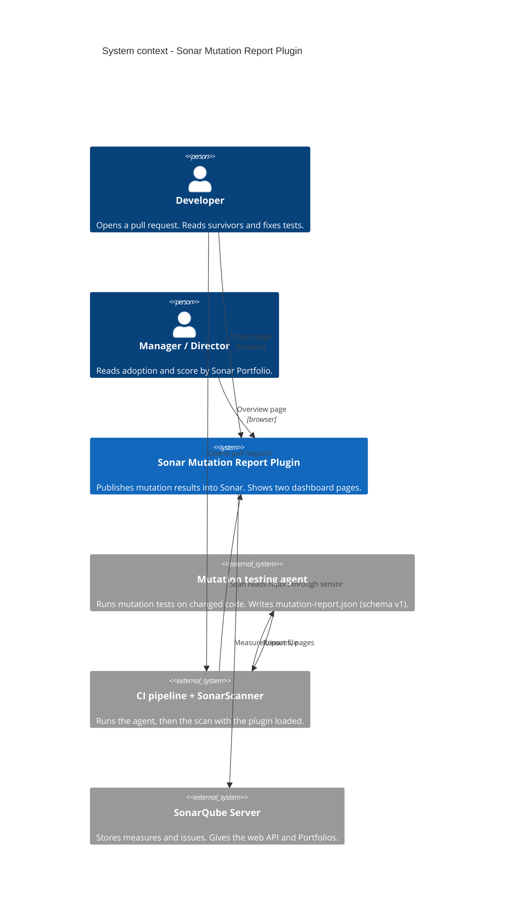

# 1. System context (C4 level 1)

Scope: the plugin as one box. Shows people and neighbour systems.

## Legend
- Person = human user. System = software. `_Ext` = outside our code.
- The agent is a separate product. The plugin only reads its JSON file.

## Key points
- The report file is the only contract with the agent: `schemaVersion` major 1.
- Sonar permissions decide what each person sees.
- Pull request analysis needs Developer Edition or higher. Portfolios need Enterprise Edition or higher.
