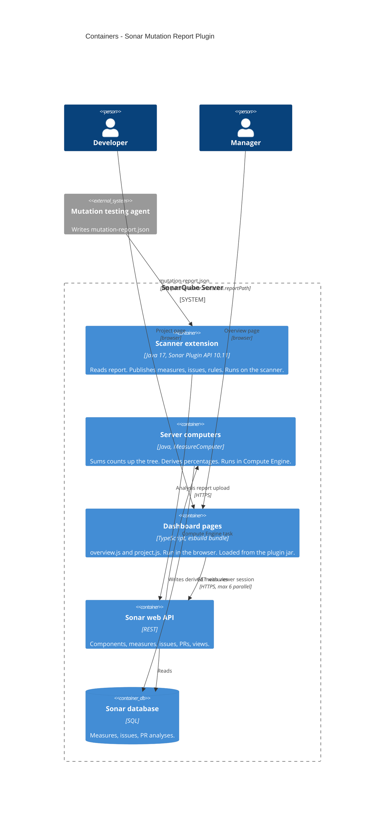

# 2. Containers (C4 level 2)

Scope: deployable parts and their links.

## Legend
- The jar is one artifact. It holds all four plugin containers.
- Scanner extension runs on the CI machine. Computers run on the server. Pages run in the browser.

## Container table
| Container | Technology | Runs on | Entry point |
|---|---|---|---|
| Scanner extension | Java 17 | CI scanner | `MutationReportSensor` |
| Server computers | Java 17 | Sonar Compute Engine | `MutationCountsComputer`, `MutationPercentComputer` |
| Metric catalog | Java 17 | Sonar server and scanner | `MutationMetrics` |
| Dashboard pages | TypeScript to IIFE bundle | Browser | `entry-overview.ts`, `entry-project.ts` |
| Page registration | Java 17 | Sonar server | `MutationPages` |

Plugin wiring: `MutationReportPlugin.define()` registers all five classes.
