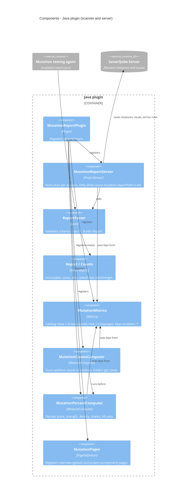
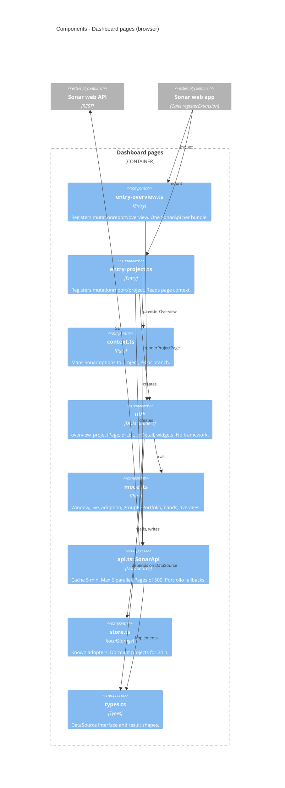

# 3. Components (C4 level 3)

Two diagrams: Java side, then TypeScript side.

## 3.1 Java side

### Rules in this side
- Sensor is passive. It runs no mutation test.
- Sensor is a project sensor, not a module sensor. Reason: project measures save once. See [ADR 0001](adr/0001-project-level-passive-sensor.md).
- Sensor saves additive counts only. Percentages come from the computers. See [ADR 0002](adr/0002-counts-in-scanner-percentages-on-server.md).
- Sensor saves per-file counts, project counts, per-language measures, one external issue per surviving or uncovered mutant.
- Files not in the analysis are skipped. Mutants on an invalid line are skipped.
- Languages: csharp, typescript, javascript, java, python, go. All others go to `other`.

## 3.2 TypeScript side

### Rules in this side
- UI depends on the `DataSource` interface, not on `SonarApi`. Tests and the dev harness use fakes.
- `model.ts` has no I/O. All score and adoption math is here.
- `store.ts` is a speed-up only. Every call swallows storage errors.
- No framework. Plain DOM helpers in `ui/dom.ts`.
- Build: `frontend/build.mjs` writes `overview.js` and `project.js` into `src/main/resources/static/`.
