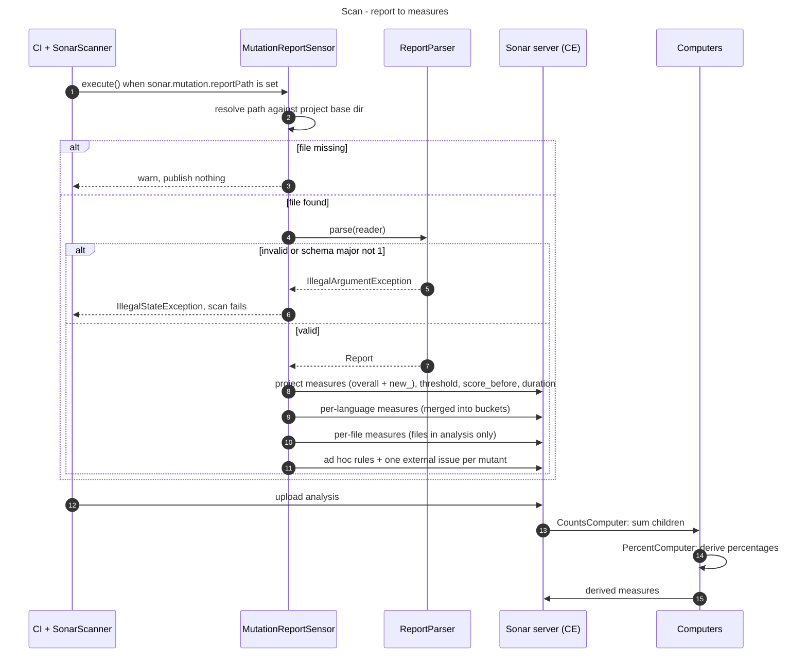
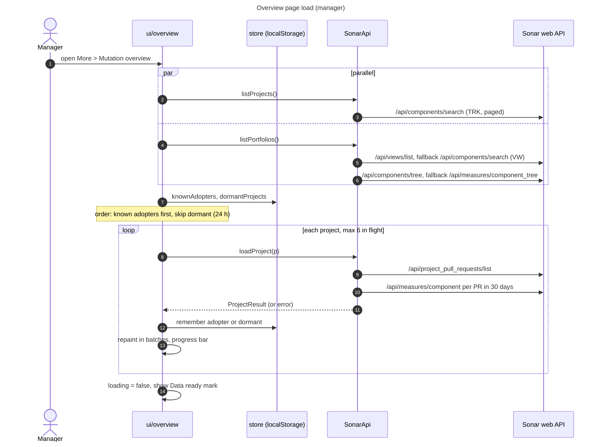
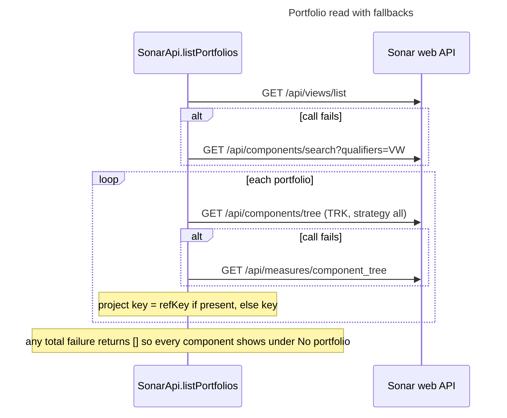
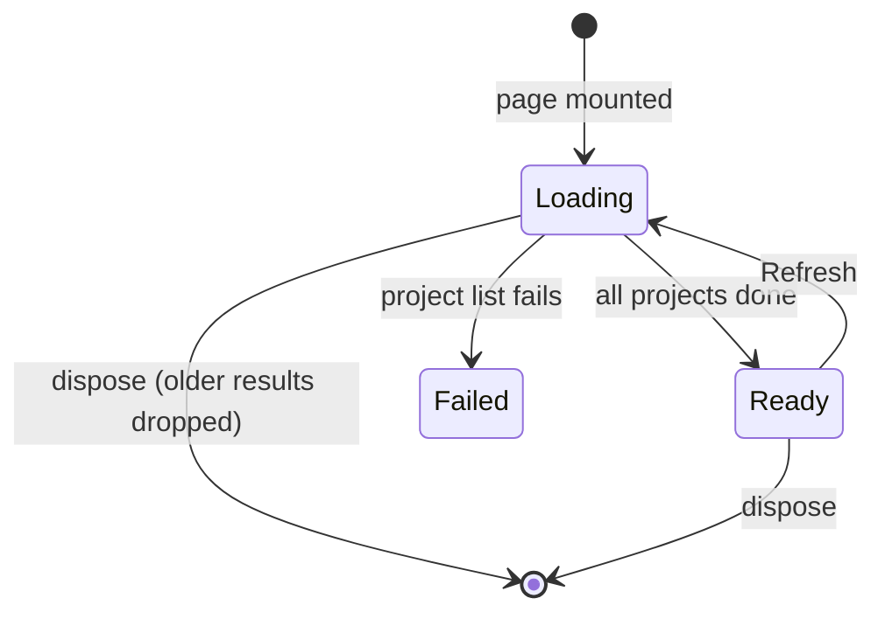
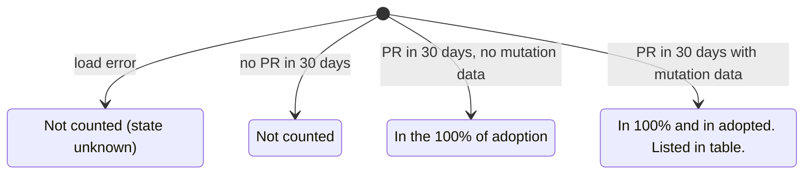

# 4. Dynamic views (UML)

## 4.1 Scan: report to measures

## 4.2 Overview page load

Notes:
- A load id drops results of an older load after Refresh or leave.
- Refresh clears the API cache and the dormant list.
- A failed project becomes `ProjectResult.error`. It is not counted in adoption.

## 4.3 Portfolio read

## 4.4 Overview load states

Loading shows a progress bar and a "partial" mark on the adoption card. Ready shows a "Data ready" mark with count and time.

## 4.5 Component status in the overview

