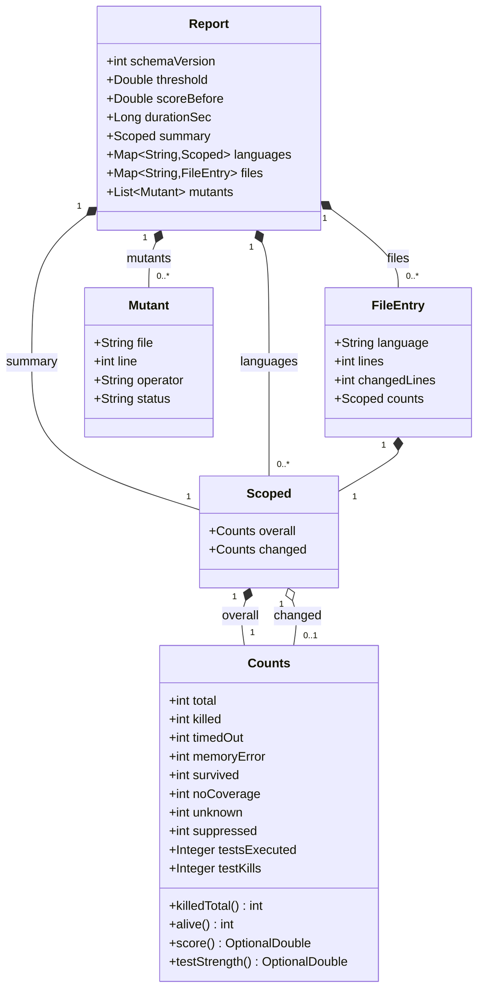
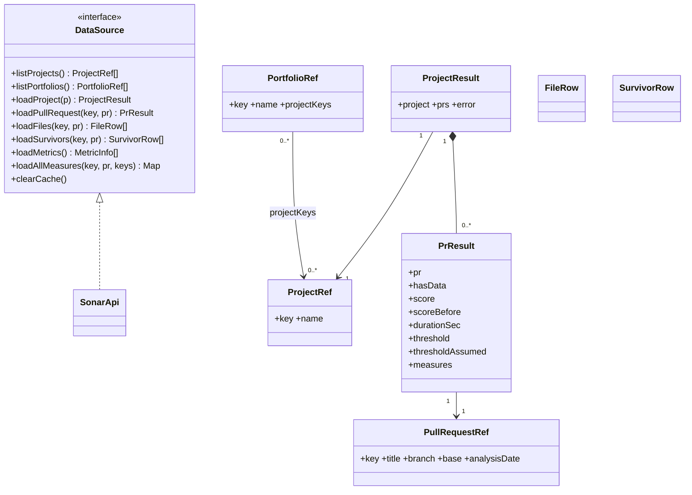

# 5. Data model (UML)

## 5.1 Report (input, schema v1)

Rules:
- `changed` = part on lines the PR changed. It maps to the `new_` metrics.
- `-1` for `lines` or `changedLines` means unknown.
- Mutant status: `SURVIVED` or `NO_COVERAGE`.

## 5.2 Metric formulas

| Metric | Formula | Where computed |
|---|---|---|
| score | killed / total x 100 | PercentComputer. Timeouts and memory errors are NOT kills here. |
| test_strength | killed / (killed + survived) x 100 | PercentComputer |
| density | total / lines x 100 | PercentComputer |
| alive_percent | alive / global_alive x 100 | PercentComputer |
| total_percent | total / global_total x 100 | PercentComputer |
| test_kill_ratio | test_kills / tests_executed x 100 | PercentComputer |
| killed_total | killed + timed_out + memory_error | Sensor (additive) |
| alive | survived + no_coverage | Sensor (additive) |

- A ratio with a missing input or zero denominator gives no measure. The page shows `-`, never 0.
- Every metric has two scopes: `mutation_*` (overall) and `new_mutation_*` (new code). Quality gates use `new_`.

## 5.3 Page models (TypeScript)

Rules:
- Default threshold is 80 when `mutation_threshold` is missing. `thresholdAssumed` is then true.
- Window is 30 days (`WINDOW_DAYS`).
- `ProjectResult.error` is set when loading fails. `prs` is then empty.

## 5.4 Sonar measures published

| Scope | Component | Content |
|---|---|---|
| Project | project | all additive counts, threshold, score_before, run duration, optional portfolio string |
| Project | project | per language: score, total, killed, survived |
| File | each file in analysis | additive counts, lines, global_total, global_alive |
| Folder | each folder | sums (by CountsComputer) |
| Issue | file line | rule `external_mutation-report:survived` or `:no-coverage` |
