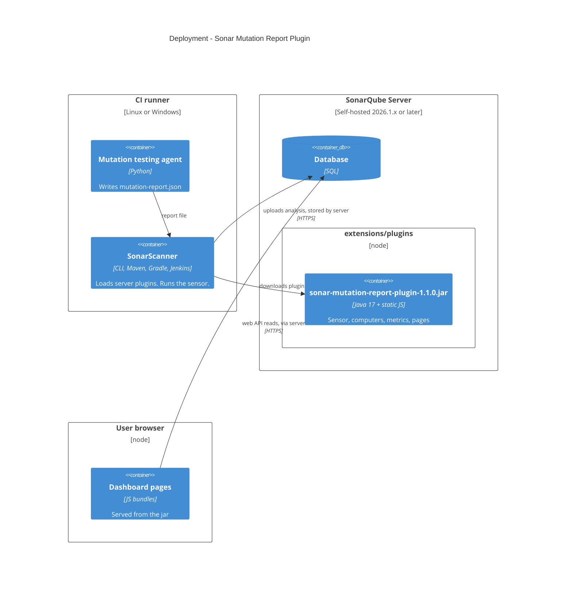

# 6. Build and deployment

## 6.1 Deployment view

## 6.2 Build
| Step | Tool | Output |
|---|---|---|
| Frontend type check | `tsc` | none |
| Frontend bundle | esbuild (`frontend/build.mjs`) | `src/main/resources/static/overview.js`, `project.js` |
| Frontend tests | vitest (`npm test`) | none |
| Java build and tests | Maven, JUnit 5, AssertJ | `target/sonar-mutation-report-plugin-<version>.jar` |
| Package | sonar-packaging-maven-plugin | plugin jar |

- `mvn package` also builds the frontend. Needs Node 20 or newer.
- `-Dfrontend.skip=true` skips it. A clean checkout then has no JS and a Java test fails.
- Compile target: Java 17. Plugin API 10.11.0.2468.
- Dev harness: `cd frontend && npm run dev`. Renders both pages with fake data.

## 6.3 Install
1. Download the jar and the `.sha256` from the GitHub release.
2. Check: `shasum -a 256 <jar>`.
3. Remove the old jar from `extensions/plugins/` (all nodes).
4. Copy the new jar. Restart Sonar.
5. First load of a new third-party plugin version: an admin accepts the plugin risk once.

## 6.4 Scan setup
Set `sonar.mutation.reportPath` (path relative to the project root). Without it the sensor does not run.
Optional: `sonar.mutation.portfolio` (free text). It is published as `mutation_portfolio`. The dashboard does not read it. It groups by Sonar Portfolio.

## 6.5 Compatibility
| Item | Value |
|---|---|
| Plugin API | 10.11.0.2468 |
| Java bytecode | 17 |
| Target server | SonarQube Server 2026.1.x and later |
| PR pages need | Developer Edition or higher |
| Portfolio grouping needs | Enterprise Edition or higher |
